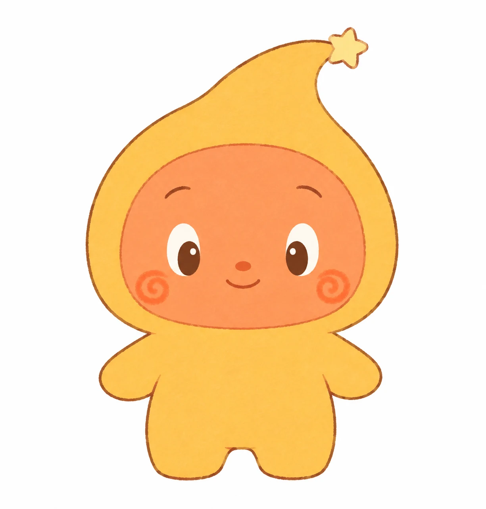
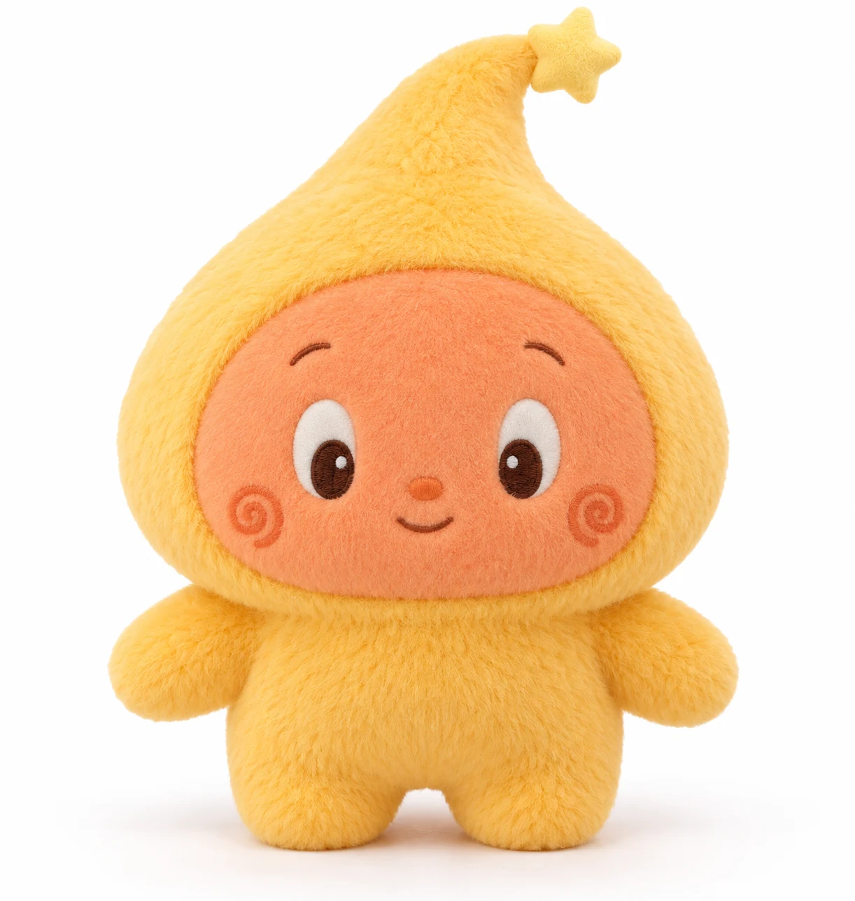
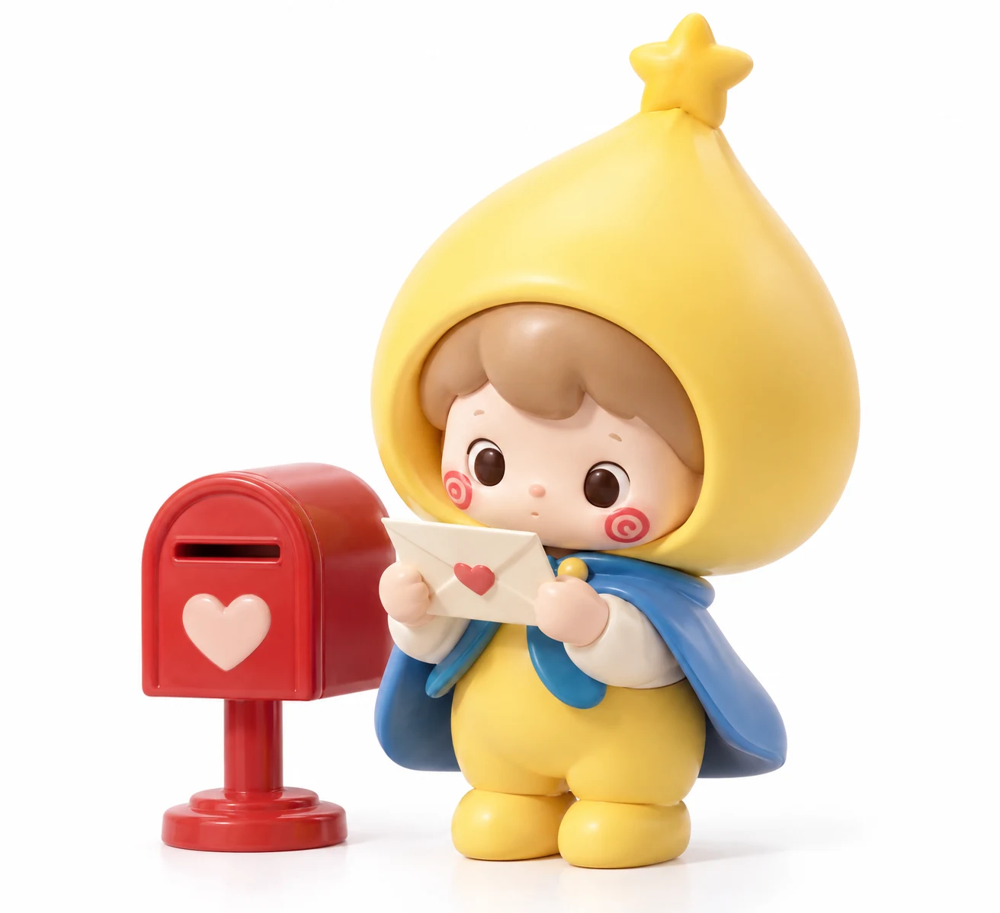
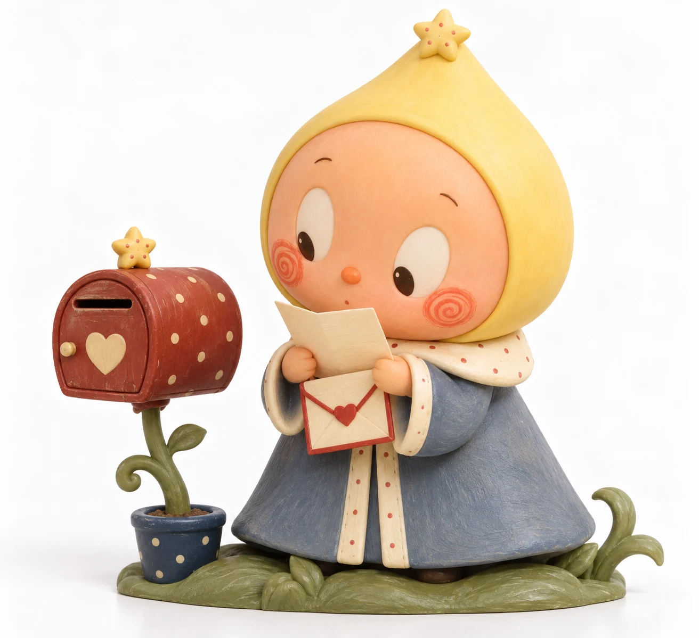
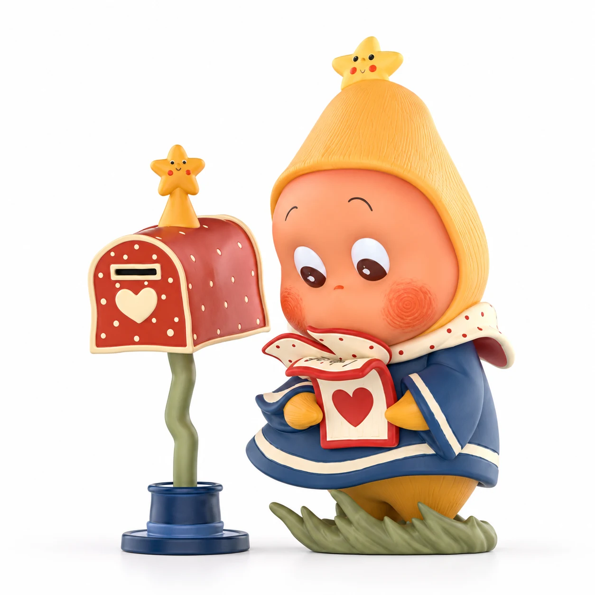
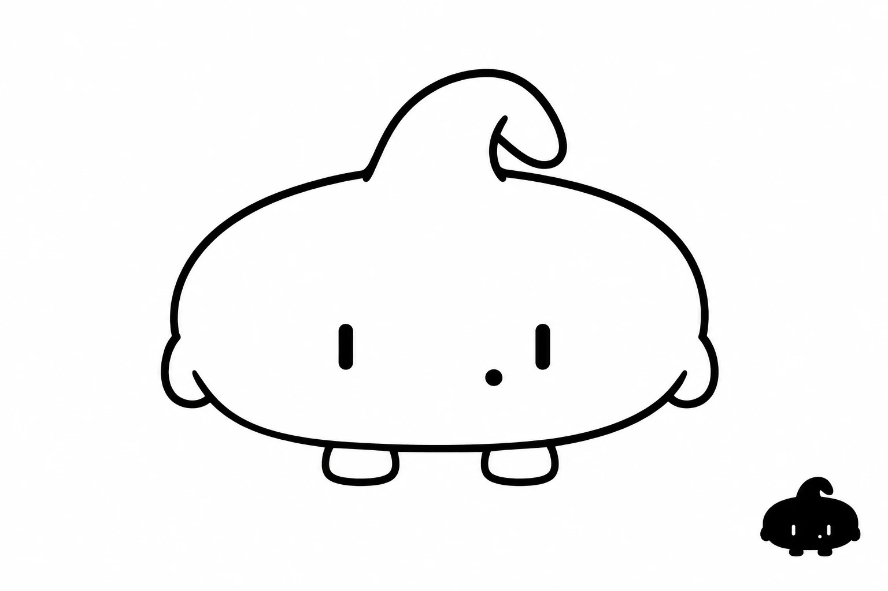
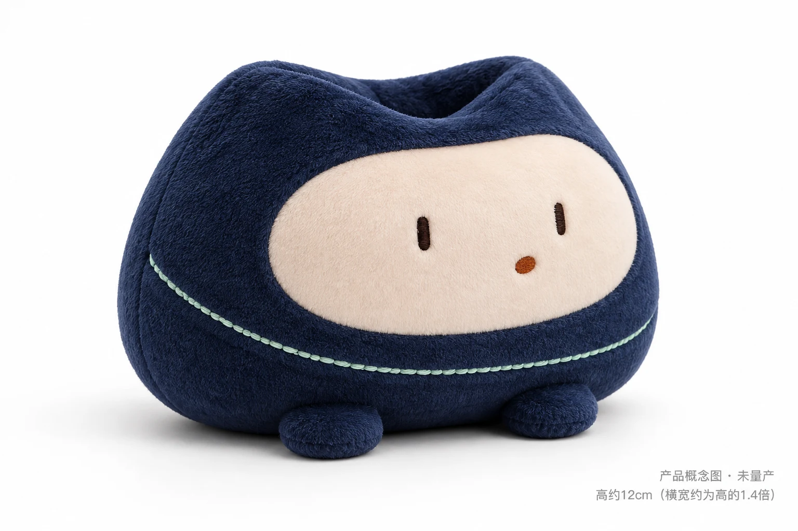
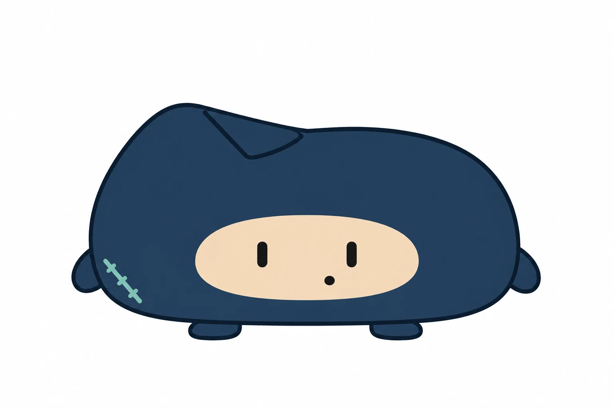
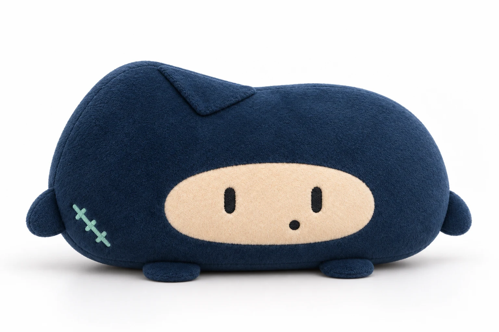

# 星星人：从故事插画到可触摸的情绪

研究截止 2026-10-19 · 按 chaowan-ip-study v0.3 接入研究库 · 35条声明／25项来源／14张视觉档案

这次重做围绕三个问题：**它最早来自哪里？颜色与造型到底怎么设定？哪些信息能交给我们的原创工作流？** 已对照GitHub仓库当前29份Markdown文件的结构，补齐出版、色彩、五官、世界观、动作和系列等字段；实际读完第一篇小红书7页介绍，并抽读第二篇16页图鉴中的7页及可见评论，逐项与官方资料交叉核验。

**主要判断：** 星星人的起盘包含持续的故事插画与后来产品开发；识别不只靠黄色或头顶小星，而是星形轮廓、面部色块、五官关系和状态表达的组合。正式画集、玩具和人偶分别承接阅读、触摸、收藏与现场关系，不应笼统归为一个“治愈需求”。[C27、C29、C31；研究归纳]

本版仍为 **partial**：已定位正式出版物、取得直接读者反馈、建立两套采样色板；最早原帖、版权页、官方色卡、完整团队资本史与玩具用户代表样本仍待补。所有判断保留证据层级。

## 出版溯源：磨铁那本书找到了

你记得的磨铁绘本，对应目前查到的 **《晚安，全宇宙：100个星星人的故事》**。封面宣传与书目能相互对应，但要分清：**出品方磨铁有狐，出版社浙江人民出版社**。不能把书店、出品品牌和法定出版社写成同一主体。[C25；S15–S17]

| 字段 | 本次核查结果 | 依据／局限 |
|---|---|---|
| 书名与副标题 | 晚安，全宇宙：100个星星人的故事 | S16书目；S15品牌商品图 |
| 作者 | 大欣绘著 | 阿力的具体合作贡献不能从本书署名反推为没有贡献 |
| ISBN | 9787213117176 | S16、S17一致 |
| 出品品牌／出版社 | 磨铁有狐／浙江人民出版社 | 分别记录，未查到出版合同 |
| 出版日期 | 三民2024-12-30；豆瓣2025-01-16 | 两者冲突，版权页未取得，不擅自统一 |
| 形态 | 双册；三民列352页、一版、平装；品牌宣传含函套及裸背锁线 | 工艺来自宣传，不等于已检查实物 |
| 尺寸 | 三民24×17cm；商品宣传185×260mm | 口径不一致，可能版本／测量不同；待核 |
| 定价 | 书目人民币158元 | 磨铁店本次售99元是渠道标价，不能混成定价 |
| 内容范围 | 宣传列300+幅、7章，新增文字与世界设定 | 未读整本，只分析可见宣传和代表页 |

### 它是不是“最早那本”？

现有证据支持两条分开的线：**作品创作可追溯到2020年；查到的正式画集版本在2024年底／2025年初。** 首套手办已在2024年8月发售，所以不能把这本正式合集直接认定为“最早出版，再变潮玩”。如果存在更早自印、画册或另一ISBN，需要独立找到同期物料。[C01、C04、C25–C27]

《梦之岛》在作者采访中是早期故事／插画线索，但本次尚未查到对应的正式出版ISBN或版权页。“绘本”可能指创作形式，不能自动认定已有正式出版物。原作首帖、正式首版、后期合集和商品首发，是四个不同事件。

### 从代表内页看表达与视觉

可见样本将角色放进路灯、人间场景与伙伴关系里；尖端和展开的星体比手办更突出，颜色不只浅黄浅粉，还借深环境托出亮主体。这些是**后期出版宣传的作品样本**，不能冒充已经保存的2020初稿。[I13；S15]

出版产品同时包含书、明信片、海报、贴纸与藏书票等媒介。值得研究的是插画资产怎样转成可阅读、可展示、可收藏的不同商品，而非只把绘本当作IP的一句背景介绍。[S15；商品宣传口径]

## 历史与权属：创作、接洽、发售分开

星星人的官方英文名称是 **Twinkle Twinkle**。官网把它与 **Nyota** 分列，不能把含“星星”的译名或聚合网页标签直接当别名。部分官方地区页的SEO标题混入Labubu，但产品正文、面包屑与独立导航指向Twinkle Twinkle；本研究按正文和跨页核验定对象。[C19；S05、S13]

官方作者页列大欣；媒体报道同时列大欣与阿力。具体创作分工、著作权与商标主体、独家范围和合同日期仍待核实。“艺术家IP”是财报分类，不能由此断言泡泡玛特买断了角色。[C02；S01、S09、S11]

| 阶段 | 能确认什么 | 证据及边界 |
|---|---|---|
| 2020 | 官方作者简介把系列创作追溯至这一年 | S09；最早公开原帖未找到，创作时间不等于首次发表日 |
| 2023 | 作者采访称泡泡玛特开始接洽 | S03；接洽年份不等于签约确日 |
| 2024-08-09 | 公司微博公布首套手办发售信息 | S04；可读到当时的产品与传播安排 |
| 2024-08-15 22:00 | 中国线上发售 | S04；北京时间，公告写明 |
| 2024-08-16 | 中国线下发售；美区产品页也列16日 | S04、S05；分渠道地区保存，不制造日期冲突 |
| 2024-08 | 大欣与星星人列入新加坡PTS阵容 | S12；公司新闻稿，不能据此估算海外销量 |
| 2025 | 人偶、歌曲与主题展成为新增表达载体 | S01；运营效果的叙述来自公司 |
| 2026上半年 | 继续开展主题展，并进入烘焙门店场景 | S02；不等于门店盈利已经成立 |

原点的研究归纳：从“无法轻易表达的思念与遗憾”出发，用童话里的小角色承接情绪。早期故事与后来产品之间的连接，值得继续查最早插画来验证。本次不把走红后的作者回忆写成已保存的同期创作档案。[S03；G02]

## 角色技术设定：从“可爱”拆到可画

### 原型、体块与身份边界

| 维度 | 本次观察 | 不确定性 |
|---|---|---|
| 原型 | 星形拟人；系列中承载多种星星人的状态与扮演 | 更接近共享语法的群体表达；完整成员边界待官方设定 |
| 轮廓 | 出版图中尖端、张开的星体明显；手办更圆润、更集中于头脸 | 不能凭后期图推断每年怎么改版 |
| 体块 | 大面部、小四肢的关系在多款重复 | 仓库“约1.5头身”只能作速记，各SKU与透视不同 |
| 记忆点 | 尖端／星形关系、桃橘面区、红颊和眼睛组合 | 并非“只要头顶加一颗星就是它” |
| 五官与留白 | 大眼白与深瞳、明显面部留白，小鼻嘴；眼形视线可变 | 不是所有载体都有相同星形高光 |
| 表情范围 | 困倦、等待、委屈、小脾气、搞怪、开心等 | 固定微笑不能代表整个IP |
| 结构 | 手办的接触点／支撑，毛绒的挂环／缝制按SKU看 | 侧背面、内部骨架、模具拆分未知，不补画成事实 |

### 头脸17项档案

| 项目 | 样本观察（非官方完整规范） |
|---|---|
| 头型 | 近圆／椭圆面区，尖端外轮廓因媒介不同 |
| 发型 | 典型样本无独立头发 |
| 发色 | 不适用，外层颜色非发色 |
| 耳朵 | 不是主要锚点，不同主题另核 |
| 头饰头套 | 尖形外层、帽或主题套装；不能一概解释为衣物 |
| 突出物 | 小星及尖端在多款出现，连接随款变 |
| 眉毛 | 小眉可挑起／压低 |
| 眼型 | 大眼白配深瞳，也有闭眼和简化眼 |
| 眼距 | 按版本观察，未测官方比例 |
| 视线 | 下视、上视、正视等可变 |
| 眼部附加 | 部分手办星形高光，其他版本可能省略 |
| 鼻 | 小鼻或弱化；主题款有额外红鼻 |
| 嘴 | 微笑、收嘴、点嘴等变化 |
| 脸颊 | 橘红色块，旋涡／擦色感因媒介不同 |
| 肤色／面区色 | 桃橘／珊瑚橘等，受材质光照影响 |
| 小标记与配饰 | 服饰与临时道具按样本归属 |
| 表情可变性 | 范围较广：困倦、委屈、小脾气、活泼等 |

上述为研究归纳，尚未取得官方模型手册。角色造型、表面材料、摄影灯光分层记录；衣物、道具和场景不能擅自升级为身份固定项。

## 色彩系统：主色、识别色、辅色分开

上一版只写“温暖配色”，不足以供设计复用。本版把色彩分成 **角色主体、系列主题、出版／场景环境**，再分主色、识别色候选、辅色、中性色与五官色。[C31]

### 角色样本色板：I02等信造型

<!-- PALETTE_ROLE -->

| 层级 | 颜色关系及作用 | 适用边界 |
|---|---|---|
| 主色候选 | 暖黄，形成外层大色块 | 典型造型锚点，不代表每个系列都通体黄色 |
| 面部主体色 | 桃橘／珊瑚橘，与外层黄形成相邻暖色层次 | 2D与实物图值不同，不当作真实肤色 |
| 识别／签名色候选 | 橘红颊色与暖色面区形成位置固定的对比 | 跨图重复较强，仍不是已经核实的官方固定色 |
| 辅助色 | 本款灰蓝披肩、红色信物 | 服务等候／读信场景；灰蓝不是全IP通用辅色 |
| 中性色 | 奶油浅色领边／纸件 | 帮助暖色层次分离，具体用量随SKU |
| 五官色 | 深棕瞳孔／线条 | I02样本取值，非官方统一印刷色 |

### 出版与环境色板：I11书封

<!-- PALETTE_ENV -->

书封中夜蓝、酒红和金黄色装饰形成剧场／夜晚氛围，**不能把夜蓝写成角色身体主色**。I04的绿色恐龙装、I10的黑白长毛及其他主题表明，系列可改变大面积色彩，识别需由整体语法共同维持。

### 色值怎样得到

本页HEX来自实际原尺寸图的指定坐标，取 **5×5像素、RGB各通道中位数**；没有做实物色卡或白平衡校正。完整坐标、图像ID、方法和局限保留在内嵌数据中。暖黄采样是图中受光的颜色，不能直接变成“星星人官方黄”。

未对主体做完整分割，所以只写“大面积／局部”，不编造主色70%、辅色20%的实测比例。未取得Pantone或供应商色卡，不输出虚构编号。毛绒、PVC、刺绣与印刷会受材料及制作影响，本轮也没有实物跨材质色差测试。

灰度、头像、剪影、简化、去道具和背景测试均列为 **未实测**。视觉分析可以提示风险，但不能伪称用户记忆实验或量产验证。

## 代表产品与视觉样本

| 产品 | 可核实规格 | 研究价值 |
|---|---|---|
| 我们都是星星人手办 | ABS／PVC；高7.5–9cm；中国线上2024-08-15，线下16日 | 首套商业化样本；道具与表情组成小情境 |
| 123!手办 | 墨西哥页列2025-04-18；PVC／ABS；高7.2–10cm | 主题、表情与动作变化；网页图片更新历史未知 |
| 我们都是星星人毛绒挂件 | 外壳100%聚酯纤维；填充80%聚酯纤维＋20%PE粒子；页面列7.5×5×13cm | 产品触感有明确材料依据，不能只写“软软毛绒” |
| 好梦气象局毛绒挂件 | 报道提及扎染、超长毛，官方纤维配比未核 | 对比长毛、身体长度与情绪表达的变化 |
| The Moment手办 | 美区官网2026-01-22 18:00 PST；PVC／ABS；8.9×9.4cm | 记录后续单体产品，不能当全球首发时刻 |

对应P01–P05；S05–S08、S11、S14。首套手办新加坡页本次标价 **S$15.90／盒**；它只是当日地区页面价格，不能当中国首发价。其他未稳定读取的价格均留空。[C11]

作者采访提到，三维化需要重新处理比例；毛绒版选择简化并使用粒子填充。这个方向与上述毛绒SKU的官方规格可以相互参照，但不能把同一填充配比推广到所有系列。[C16、C12；S03、S08]

### 代表图片与逐图拆解

以下为真实来源图片留存，不是AI生成；权利仍属于各原权利人。用于本次私人研究审阅，尚未取得公开网站再分发许可。每张图的原页面、原图URL和文件哈希见数据档案。

**I02｜等待通过视线和信件发生。** 黄色头套上端收窄，圆脸下视信件，蓝披肩与红色邮筒构成关系。视线把两件物体连成一个动词：“等／读”。单张产品画面有了叙事，不依赖长篇背景解释。这里的“情绪可读”是研究判断，尚无用户识别实验。[S05；V02]

**I03｜小脾气是一种行为。** 眉毛和眼神向上，小嘴收拢，禁止打扰牌与路锥把拒绝外界变成场景。橙白锥帽是这款主题，不能变成角色永久设定。大场景的街道、信号灯和建筑只属于宣传呈现。[S07；V03]

**I04｜换装没有消除脆弱。** 绿色恐龙衣包住圆脸，眉尾、泪滴和小嘴塑造需要安慰的状态；粉色小玩偶提供关系线索。绿色已经说明“所有款必须通体黄色”不是从跨图证据得出的规则。看上去有纹理，不足以判定植绒或手工涂装。[S07；V04]

**I05｜它也可以好动。** 闹钟结构、歪身站姿、红鼻和蓝胡子让角色进入搞怪情境。与I02对比，瞳孔朝向、嘴型和动作可以变；若只从一张忧郁图提炼“固定无神表情”，会误读它的情绪范围。[S07；V05]

**I09｜同一类脸部关系转成纺织表达。** 可见刺绣眼睛、鼻嘴与面部色块，黄色绒面和短小四肢减少硬质道具依赖。此图没有依据证明它是搪胶脸；应按P03记录为聚酯纤维毛绒。内部填充配比来自规格，不是凭照片猜测。[S08；V09]

**I10｜材质和身体长度也能成为系列变化。** 图中长毛包围、长腿、雨衣与雪人等版本差异明显，面部仍形成重复联系。图片来自媒体，细节清晰度不足以核定纤维和全部工艺。它支持“不同天气通过不同身体处理表达”的视觉分析，不能证明每个款的销量。[S11；V10]

另外保留I07系列题头及I08挂环织带局部，用来区分产品名称、结构和角色设定。标准正侧背、最早插画和真实用户使用照仍是缺口。

### 不变量／变量：研究暂定表

| 类别 | 本版判断 | 边界 |
|---|---|---|
| 身份候选不变量 | 圆脸、明显颊部色块、头部突出端点与星形符号的重复关系 | 多样本归纳，不是官方模型手册；缺背面 |
| 表达候选不变量 | 童心与不强硬的情绪表达，允许脆弱和活泼共存 | 需更多日常内容检验 |
| 可变项 | 表情、视线、服装、主题色、材质、动作、故事道具 | 不是所有变量同时改变都能保持识别 |
| 载体适配 | 手办用情境道具；毛绒需要适合缝制与触摸的简化 | 未完成量产结构对照，不能直接下工艺结论 |

## 工艺转译补查：手绘感怎样保留

除了基材，本轮增加了“部位—表面—五官工艺—连接—触感”的资料层。采访转载提到首套开发约一年半，并使用移印加擦色的油色工艺保留插画感；该来源的原刊待核，因此标为**采访转载自述**，不升格为官方生产规范。[C30；S18]

这与照片里看见细纹是不同层级：照片可见不等于能确认工艺。现有官方规格能确认P01/P02的PVC／ABS及P03的纺织外壳和填充配比；移印、擦色、扎染、长毛等具体工序须逐系列定位证据。

| 部位或载体 | 可确认／可观察 | 不能擅自补齐 |
|---|---|---|
| 手办 | 官方基材；图中面区色层、瞳孔及局部高光 | 未见模具和工艺卡，不推全部零件或涂料 |
| 毛绒 | 某SKU聚酯外壳、80%聚酯＋20%PE粒子填充；图中刺绣与绒面 | 不一律写搪胶脸，不从照片得出毛长毫米数 |
| 图书 | 商品页封套、裸背锁线与纸质赠品宣传 | 未触摸实物，不评定纸张克重、触感或成本 |
| 人偶／舞台 | 现场内容为运营载体 | 尚无结构和演出手册，不写虚构动作工艺 |

## 世界观、动作与系列：补到能交接

| 创作端问题 | 目前能研究到什么 | 仍待补什么 |
|---|---|---|
| 住在哪里 | 出版样本有宇宙童话与人间场景 | 唯一官方住所及地理规则 |
| 每天做什么 | 等信、睡梦、奇遇等代表情境 | 连续日常节奏，不能从单帧补全 |
| 想要／害怕 | 连接、希望可作研究归纳 | 未核官方恐惧与明确欲望，不编造 |
| 与用户关系 | 陪伴、自我投射是候选解释 | 分层用户验证 |
| 动作 | I02读信、I03举牌有可见姿态 | 起始—过程—结束未见，不伪称已观察动画 |
| 系列 | 主题、表情、身体、材料可承接不同状态 | 完整SKU、概率、补货和失败系列 |
| 不变量 | 跨样本提取身份语法候选 | 族群与单角色区别、官方授权边界 |

## 读者证据：现在有直接样本，也有反例

本次实际读到豆瓣书目页面可见的5条短评，按“发现来源、反例、收藏诉求”选取3条**转述**入库。它们代表画集读者，不是玩具粉丝全体；购买为用户自述，未核订单。[S16；U03–U05]

| 日期与样本 | 可见反馈转述 | 对研究的作用 |
|---|---|---|
| 2025-01-18／U03 | 从小红书推荐发现，预售等待后读上册 | 有“社媒发现→书籍购买自述”的路径线索 |
| 2025-02-08／U04 | 认可画面可爱，对故事评价较低 | 视觉喜好不等于叙事满意，更不能说故事人人喜欢 |
| 2025-01-17／U05 | 支持签名版、喜欢随书物料，也希望纸张更好 | 作者支持、收藏赠品和材料品质是不同购买／评价维度 |

小样本最有价值的是提出可验证的问题：买家买的是画面、角色、故事、作者支持、触感，还是收藏物料？下一轮分别调查，不先用“情绪价值”把答案合并。

## 小红书介绍笔记：入口有用，结论逐项回查

你分享的《每天认识一个潮玩IP·第6期｜星星人，治愈》已在浏览器实际读完 **7/7页**，作者为温粥；页面显示“04-18”，年份未直接显示。笔记当次可见51赞、22收藏，仅属于这一篇笔记，不能当星星人的总粉丝。[S21]

| 笔记给的线索 | 与本轮资料如何对照 |
|---|---|
| 2020创作、梦之岛、后续100个故事 | 与作者采访方向接近，继续查最早原帖和出版物身份 |
| 接触、正式签约与3D开发 | 2023接洽有采访记录；正式签约确日仍待合同，不把2024一句概括当完整史 |
| 初代手办6款 | 与官方页9盒不一致；手办与6盒毛绒要分清 |
| 金黄、红脸、星光眼、温暖微笑 | 典型概括可作线索；绿色主题及委屈小脾气等构成边界反例 |
| 年收入与二手溢价、平台排名 | 年收入回财报；二手成交、叫价、排名和想买人数分别需要原始日期与口径 |
| 插图 | 未全部标原图来源，不能直接用作官方角色设定；本网页技术样本以品牌产品／出版材料为据 |

“IP名＋品牌介绍”已纳入Study检索流程；先读用户给的笔记，再追作者、品牌和原始资料。非官方笔记不会被忽略，也不会因写得完整就自动成为事实。本次并未宣称已穷尽小红书全部内容。

### 第二篇产品图鉴：从单款手办补成跨品类地图

《⭐️星星人图鉴来啦｜盲盒吊卡大娃周边大合集》作者王小胖没烦恼；浏览器实际抽读第1、2、4、7、10、13、16页，共7/16页及可见评论，未将未读页写成已完成。页面日期显示09-28，年份未直接显示；图中有2026-10-01产品日期，不能用页面日期猜每张图最后更新日。采集当次531赞、398收藏、18评论，仅作单篇记录。[S22]

| 交叉项 | 图鉴／介绍笔记 | 官方核验与当前结论 |
|---|---|---|
| 初代手办数量 | 介绍笔记称6款；图鉴第13页展示9常规＋1隐藏 | S05列9常规＋隐藏，支持图鉴；不能把6盒毛绒套给手办 |
| 初代发售日 | 图鉴第13页2024-08-15 | S04为中国线上15日22时、线下16日；S05美区列16日，需按地区渠道读 |
| 123系列日期 | 图鉴第10页2025-04-17 | S07墨西哥页列18日，保留地区差异，不据此判图鉴错误或声称全球首发 |
| 农场搪胶毛绒 | 第1页标2026-08-20，6常规＋隐藏 | S23美区官网同日19时PST；尺寸不含织带13–18cm，吊带含环6.5cm；聚酯、锌合金、PVC，填充含塑料粒子，部分款含粘土粒子 |
| 月球冰淇淋毛绒 | 第4页4常规＋隐藏，不同色、口味和表情 | S24日本官网同为4＋1，高约11.3cm，含PVC、聚酯、磁铁、铁；中国2026-04-16发售日期本轮仍仅图鉴线索 |
| 卡包、手机挂环、杯、靠枕 | 第2、7、16页补充功能周边 | S25墨西哥官方目录确认手机配件、杯、靠枕及卡夹等品类存在；每款中文名、规格和中国发售日尚未逐SKU追齐 |

**产品结构的研究判断：** 同一主题可以进入手办、POP BEAN、挂件、随身收纳、手机配件和家居品。它们并非简单放大缩小：陈列产品靠姿态与场景，随身产品要处理挂点、耐用与重量，功能周边要让角色与使用动作配合。以上是开发启示，尚无品类销售占比证据，不能把品类多直接说成增长原因。[S22–S25；研究推断]

**“大全”仍需检查漏项。** 作者置顶说明漏掉“信使星”，可见评论也在追加新品；本图鉴可作线索地图，不能叫截至今日的全量SKU库。把“手办／毛绒盲盒／单体吊卡／大娃／功能周边／出版物”分别建表，保留图鉴覆盖日期和官方核验状态。此次未逐格核实全16页，完整全品类清单仍列下一轮。[S22]

## 内容、媒体与营销

**首发路径。** 官方微博把角色态度、产品信息、线上线下时间表和互动抽奖放在同一条内容里；这是一次可核实的传播设置。它能连接“被打动”与“知道去哪买”，但没有证据说明抽奖贡献多少成交。[C20；S04]

**内容扩展。** 2025年报披露歌曲、明星朋友及主题展等运营动作。应把官方所说的内容表现标成公司自述，不把它当独立粉丝调查。原来的插画可以给情绪语境，人偶则让它具备现场回应的能力。[C14；S01；后一判断为研究推断]

**关系与转化。** 虎嗅报道提供了现场观察和周边销售环比增长的线索。其“80%”口径缺原始窗口、SKU和控制变量，本版只将它列作待验证的协同信号。同期新品、游客、补货与表演可能共同变化。[C18；S10]

| 媒体／渠道 | 已确认角色 | 当前指标 |
|---|---|---|
| 公司微博 | 首套手办公告、导购与互动 | 仅缓存页面；粉丝与互动数不作当日数据 |
| 星星人微博 | 首发公告提及专属账号 | 主页读取失败，粉丝null |
| 作者小红书 | 采访确认曾持续发布，筹备产品时频率有变化 | 已读指定第三方介绍笔记；作者账号近期频次与粉丝仍null |
| 乐园与线下主题展 | 现场表演、互动与情境体验 | 未取得IP独立漏斗 |
| 国际官网及POP NOW | SKU说明与购买 | 不把全品牌流量算成星星人流量 |

本次已增加书目、音乐和指定小红书7页介绍笔记，但仍无法计算“近期30天日常内容中位数”。不使用媒体提及量、话题浏览或二手溢价代替账号粉丝。[G04]

## 商业与组织：规模能确认，归因需谨慎

| 期间 | 星星人收入：人民币 | 占集团收入 | 口径 |
|---|---:|---:|---|
| 2024全年 | 1.20788亿元 | 0.9% | 2025年报比较数 |
| 2025全年 | 20.55580亿元 | 5.5% | 2025年报按IP收入 |
| 2025上半年 | 3.89363亿元 | 2.8% | 2026中期公告比较数 |
| 2026上半年 | 26.49969亿元 | 15.4% | 2026中期公告，未经审计 |

数据来自年报第27页和中期公告第30页，已检查原表。[C06–C09；S01、S02] 这是泡泡玛特集团确认的IP收入，**不是作者收入、授权费、全行业零售规模或二手交易额**。半年和全年分列，不能直接据这四个数描述连续的同口径环比。

运营方是泡泡玛特这一上市集团平台，公开定位覆盖角色产品与沉浸体验；年报说明其持续拓展产品与内容。本版未完成公司完整融资史，也未查到星星人专属团队人数、预算及分成。不能用集团人数冒充项目团队，更不能说“两个插画师就做出了相同商业规模”。[S01、S13；G03、G09]

从岗位看，案例提示我们需要区分 **角色创作、产品转译、商品开发、渠道、内容表演** 几种能力。这是研究用的职责拆分，不是已核实的泡泡玛特内部组织图。[C16、C23；研究推断]

## 时代窗口与替代解释

**可以提出的窗口机制：** 毛绒和随身使用形式扩大了角色接触情境，现场表演与短视频传播又可能让尚不看绘本的人先认识角色。泡泡玛特已有渠道和产品开发能力，使接触后购买的路径较短。[C23；S01、S08、S10；研究假设]

**还不能证明的部分：** 这是否主要来自当时的社会情绪？是否由明星带货主导？设计比供给、店铺流量或新品节奏重要多少？本次没有同期对照样本，不能用“时代红利”代替回答。[G05、G08]

二手价报道只能证明报道时的市场现象，不能证明成交规模或长期支付意愿。也未检得足以完整复盘的失败系列；“没有找到”不等于“从未失败”。[S11；G06]

对新IP最重要的可复制边界：你可以低成本测试一个情绪动作、一种触感、一段互动，却不能把大型品牌的门店、人偶团队与存量粉丝当成新作者天然拥有的条件。

历史提示词与测试记录：基础造型未通过，不属于正式可用词

## 提示词：先找形，再上色，最后转实物

**说明：下面是根据可见作品的研究重建，不是作者原始提示词，也不意味着作品由AI制作。原创转译只借用机制，重新建立身份。**

### 第一层：研究性样本描述（I02）

角色本体：圆脸小角色位于上窄下圆的黄色头套内，顶部有小星，红色旋涡脸颊；视线落向手中信件，穿蓝色披肩。产品关系：旁边有爱心邮筒，动作构成等候／读信。材料：这一SKU官方列ABS／PVC。呈现：官方产品图；白底不是角色设定，侧背面不可见。

这段用于检索和理解样本，不把它直接作为新IP设计模板。

### 第二层：可以借鉴的设计机制

| 可见特征 | 感知假设 | 可迁移的问题 |
|---|---|---|
| 视线、信件、邮筒组成一条关系 | 在一个画面里读懂等待 | 新原点能否变成一个不用旁白的动词？ |
| 红脸、圆脸等关系重复，表情主题变化 | 换情境仍有主体连接 | 哪些关系保持稳定，哪些变量承担内容？ |
| 毛绒版简化、触感有材料依据 | 从“看懂”进入“带着与摸到” | 新角色的产品是否让表达成为身体经验？ |
| 人偶与音乐产生可重复行为 | 角色在现场仿佛能回应 | 不建乐园，能否用一个独特动作测试关系？ |

上述都是有边界的候选方法，不是“已证明的畅销配方”。

### 第三层：星星人基础形象 · 两段出图提示词

**更正说明：** 原网页此处的“平面设定图／实物概念图”写成了墨蓝扁豆角色「缓冲」，未满足星星人基础形象的验证目标。现在改为下列两段。它们按已留存出版插画及产品样本归纳，属于研究重建，不是取得官方设定手册后的标准母版。平面与毛绒存在载体差异，不以单款等信手办定义全部基础形象。

**基础平面图 · 中文（已纯文字实测）**

> 星星人Twinkle Twinkle的基础角色研究重建，不设计新IP：一整只暖金黄色的小星灵，头部与身体由同一个黄色外壳连续构成，短胖、无脖子、约1.5头身；头部上方收成一个柔软略弯的短尖，尖端带一枚很小的浅黄色五角星。下方短小身体，两只短短向斜侧伸出的圆钝星角手和两只分开的短圆脚，不能是人类婴儿穿衣服，也不是几何对称五角星、墨蓝扁豆或黄色熊。头部正面嵌一大片橙桃色圆脸，圆脸两侧到黄色外壳仅一圈窄边，脸色为#F3966C附近的暖橙桃，不是乳白面区。宽额头，两枚较小竖椭圆白色眼白，深棕瞳孔在下部，瞳内小白点；细细弧眉，极小橙色鼻，短而克制的小嘴微微上弯。左右脸颊为低对比橙红色细密旋涡，#DF6132附近，不是粉红圆贴；黄色外壳#FFBB6E附近，明快温暖但不是荧光柠檬黄。没有头发、人耳、衣服、蓝披肩、信件、邮筒或其他主题道具。身体全部保持暖黄，面部保持暖橙，星饰是微小点缀。白底单角色正面全身居中，无文字标志水印。 媒介：平面角色基础设定图，干净稳定的手绘轮廓、实色色块，轻微纸感；不加3D体积、投影、环境光或棚拍效果。不画背面、不多角色拼贴。

**基础毛绒概念 · 中文（已纯文字实测）**

> 星星人Twinkle Twinkle的基础角色研究重建，不设计新IP：一整只暖金黄色的小星灵，头部与身体由同一个黄色外壳连续构成，短胖、无脖子、约1.5头身；头部上方收成一个柔软略弯的短尖，尖端带一枚很小的浅黄色五角星。下方短小身体，两只短短向斜侧伸出的圆钝星角手和两只分开的短圆脚，不能是人类婴儿穿衣服，也不是几何对称五角星、墨蓝扁豆或黄色熊。头部正面嵌一大片橙桃色圆脸，圆脸两侧到黄色外壳仅一圈窄边，脸色为#F3966C附近的暖橙桃，不是乳白面区。宽额头，两枚较小竖椭圆白色眼白，深棕瞳孔在下部，瞳内小白点；细细弧眉，极小橙色鼻，短而克制的小嘴微微上弯。左右脸颊为低对比橙红色细密旋涡，#DF6132附近，不是粉红圆贴；黄色外壳#FFBB6E附近，明快温暖但不是荧光柠檬黄。没有头发、人耳、衣服、蓝披肩、信件、邮筒或其他主题道具。身体全部保持暖黄，面部保持暖橙，星饰是微小点缀。白底单角色正面全身居中，无文字标志水印。 媒介：同一基础角色的黄色短绒毛绒公仔概念。橙桃色脸为平整短绒拼片，白眼白、棕瞳、细眉和小嘴为精细刺绣，腮红为低对比印染旋涡；身体与短四肢使用细软暖黄色毛绒，顶部小星同为织物，无硬塑大脸。结构短胖，四肢与星形身体连贯，无圆熊肚、衣领或独立大头。真实细密短绒与轻微重力感，白背景柔光产品摄影，全身单件。

**本轮复核：** 两张均未附参考图生成，纠正了之前墨蓝扁豆、白面区和薄荷缝线的对象错位。暖黄色外壳、橙桃脸、白眼白与棕瞳、细弧眉、橙红旋涡腮红及微小星饰已能生成。但身体仍偏普通短四肢人形，头顶尖部与小星大小不完全稳定，不能标“官方形象复现通过”。下一轮应明确锁定一个可核验的无主题基础样本，再校正星形肢体和头身关系；不将绘本与不同产品的比例混成一张官方标准图。

此前误置的原创「缓冲」示例（不是星星人复现词）

**新原点：** 每次事情告一段落，需要几秒钟才能切换。**表达：** “等一下，我还在缓过来。”**人群假设：** 工作切换频繁、回家也暂时说不出话的成年人。**首场景：** 桌角陪伴；首产品为纺织豆袋概念，尚未打样。

**身份固定项：** 横向扁豆形身体，无独立大头；顶部有一个向内折下的宽软角；双眼为低位、间距较宽的短竖线；两条超短片状脚；嘴是偏右的小圆点。**系列变量：** 折角倾斜、双手停顿动作及面部朝向。**配色：** 墨蓝为主、淡杏脸部小区、薄荷色单条接缝；无星形、圆形红腮、兜帽或星瞳组合。

**黑白找形 · 中文**

> 原创抽象角色线稿：无独立大头的横向扁豆身体，宽约为高的1.4倍；顶部一个宽软角向内折。两条短竖线眼睛位于身体中下部且间距宽，圆点嘴偏右，双手贴身，两条短片脚。白底，均匀中粗黑线，正面全身居中。右下角加同角色同姿势的小黑剪影，高约主体六分之一。不上色，无阴影、材质或额外道具。

**Line art · English**

> Original abstract character line art: a horizontal bean body 1.4 times wider than tall, no separate oversized head, one broad soft top corner folded inward. Low, widely spaced short vertical eyes, a dot mouth offset right, arms resting against the body, and two short tab feet. White background, even medium-weight black lines, centered full-body front view. Lower right: a small solid-black silhouette of the same character in the same pose, about one sixth of its height. No color, shading, texture, or extra props.

**平面上色 · 中文**

> 为“做完一件事，需要暂停几秒”的情绪设计一个独立抽象角色。身体是横向扁豆形，宽约为高的1.4倍，无独立大头。顶部一个宽软角向内折，双眼是位于身体中下部、间距较宽的两条短竖线；一枚小圆点嘴偏右。两条超短片状脚，双手贴身停住。主色墨蓝，小面积淡杏色面部区域，一条薄荷色接缝。白底正面平面设定，清晰轮廓、少量实色色块、无体积渲染。不要星形、兜帽、圆形红腮、星形高光或现有角色标志。

**Flat color sheet · English**

> Design an original abstract companion expressing a brief pause after finishing a task. A horizontally flattened bean body, width about 1.4 times its height, with no separate oversized head. One broad soft corner folds inward at the top. Two widely spaced short vertical eyes sit below the body's midpoint; a tiny dot mouth is offset to the right. Two very short tab feet; small arms rest against the body. Ink blue, a small pale apricot face area, and one mint seam. Front view, white background, clean silhouette and flat color blocks, no volumetric rendering. Exclude stars, hoods, round red cheek patches, star-shaped eye highlights, and existing character emblems.

**实物概念图 · 中文**

> 将同一扁豆形角色转成高约12cm的桌面纺织豆袋概念。严格保持横宽1.4倍高、顶部内折宽角、低位宽眼距短竖线眼睛、偏右圆点嘴与短片脚。墨蓝短绒外壳，淡杏小面区拼片，五官刺绣，一条薄荷色装饰缝。无硬塑脸和硬质配件。宽平底，填充腔需另行打样评估，避免在图中展示未经验证的剖面。白色无缝背景、柔和棚光、正面略偏15度、全身；明确这是未量产的产品概念。不要星形、兜帽或圆形红腮。

**Product concept · English**

> Translate the same character into an approximately 12 cm tall textile desk beanbag concept. Keep the body 1.4 times wider than tall, the broad inward-folded top corner, low widely spaced short vertical eyes, offset dot mouth, and tiny tab feet. Ink-blue short-pile shell, small pale-apricot face panel, embroidered features, and one mint decorative seam. No rigid plastic face or hard accessories. Broad flat base; internal filling chambers require prototyping and must not be shown as a validated cutaway. White seamless background, soft studio light, front view turned about 15 degrees, full body. An unmanufactured product concept. Exclude stars, hoods, and round red cheek patches.

**人工复核项：** 扁豆与折角是否能独立识别；小图是否变成普通蓝色抱枕；缝制后折角能否保持；面部位置是否过低；相似性需要跨品牌检查。本轮已实测出图，结果见下节；未验证用户偏好，不使用“原创已保证”之类结论。

## 此前出图实测与修订记录 · 2026-10-19

本轮使用内置图像生成，共8张：星星人文字基线、补全文字、参考图重建各1张；「缓冲」旧版线稿／平面／毛绒各1张，以及修订平面与参考图毛绒各1张。中英文是同一方案的语言版本，本轮实测中文；不是双语分别验证。以上旧提示词保留为测试基线，当前使用本节修订版。生成图均为AI研究测试，不是官方新品或官方原图，不替代上一节的原始证据。

### 星星人：研究描述不能直接当作稳定复现提示词

| 轮次 | 输入方式 | 实际观察 | 判断 |
|---|---|---|---|
| A1 | 原研究描述，纯文字 | 自增头发与普通婴儿五官，星顶饰过大，普通立杆邮筒 | 身份差距大，不采用 |
| A2 | 补足面部、服装、邮筒结构，仍纯文字 | 橙脸、眼白、斗篷与草底座改善；头部过大，塑料误成粗陶土 | 改善但不满足同款复现 |
| A3 | 官方I02参考图＋身份保持提示词 | 轮廓、眼睛、斗篷前襟、独立底座及材质明显更接近 | 本轮最接近；仍有顶饰大小、纹理粗细与细部偏差，非逐像素还原 |

**纯文字修订版（A2，保留其失败边界）：**

> Use case: product-mockup. 一张既有潮玩角色等信造型的研究性文字重建图，单件ABS/PVC手办，白底，完整全身，正面向画面左侧转约20度，柔和棚拍。按结构绘制：头部是高且向上收窄的黄色一体星灵外壳，圆弧顶偏尖而不细长，整个外壳紧贴包围一张很大的橙桃色圆脸；不是人类穿兜帽，没有头发、刘海、人耳、额外帽檐。圆脸占头部外轮廓宽度约80%，额头宽大，外壳边仅为一圈窄黄边。眼睛是两枚偏竖椭圆的乳白眼白，棕色小瞳孔落在眼白下半部、一起朝左下信件看；不是全黑大眼，不要星形瞳孔。细弧眉，小小突起橙色鼻子，两颊各一片橙红手绘密螺旋，嘴极小不强调。顶部仅一枚很小的淡黄五角星，宽约脸宽1/5，带微小红点。脸大身体短，短小身体大部分被灰蓝色宽斗篷覆盖，奶油色翻领布满细红点，斗篷前襟双奶油条边，下摆宽而平。小圆手在胸前捧打开的奶油色信纸，红边信封垂在胸前，封面一颗红心；不要婴儿服、裤腿或大鞋。角色置于一小片灰绿弯曲草叶底座上，脚几乎被遮。角色左侧独立红棕色圆顶横向邮筒，比角色低，筒身有奶油小点和短划、奶油爱心门与细邮件口；细弯草绿色支杆插在小深蓝花盆内，邮筒顶部一枚小星。邮筒与角色均完整在画面中，星与脸不要夸张放大。材质是温润低光泽涂装塑料，带细微手绘擦色和斗篷细纹，非毛绒、非瓷娃娃，无文字水印。

**历史参考图重建测试词（A3，必须附I02原图；非正式可用词）：**

> 输入图I02是唯一身份、比例、姿态及服装参考。生成同款ABS／PVC手办的清晰白底棚拍重建图，保持角色窄高头套、脸与短身体比例；禁止增大头部、添加头发或人耳。保留橙桃脸、细眉、小橙鼻、较小的白底棕瞳双眼向左下看信件，以及温暖旋涡脸颊；眼睛高度、间距、头顶小星大小按原图。灰蓝短宽斗篷，奶油红点翻领，奶油双细条前襟及下摆，小黄手拿红边爱心信封与打开的信纸。角色右、红棕奶油点划爱心邮筒左；保留独立的灰绿草叶底座与弯绿杆深蓝小花盆，不增加盆栽叶或额外装饰。细腻低光泽涂装塑料，不做木雕、陶土粗颗粒或毛绒。只提高清晰度，不重新设计，完整全身、柔和棚光，无文字水印。

这里的提升同时来自提示词补充和参考图，不把A3改善归因于纯文字能力。仅一个SKU、单次每版，尚未检验不同随机结果的稳定性。

### 原创「缓冲」：先修母版，再转换材质

| 轮次 | 观察 | 处理 |
|---|---|---|
| B1 旧线稿 | 折角成卷尖；小剪影挖出白色五官，并非纯黑 | 旧线稿不作为母版 |
| B2 旧上色 | 卷尖高起，面区偏大，缝线位置不受控 | 用具体部位、相对尺寸约束代替模糊形容 |
| B3 旧毛绒 | 顶部变双尖凹口，缝线环绕身体，手缺失 | 不能认定三个载体身份一致 |
| B4 修订平面 | 单个宽折片、低位小面区、左下短斜缝均更明确 | 仍有轻微渐变，横宽比例未严格达1.4；只作试验母版 |
| B5 B4图转毛绒 | 折片、面区、短斜缝和四肢关系保留较好 | 本轮跨材质一致性改善；未验证缝制可行性与用户偏好 |

**当前平面修订词（B4）：**

> Use case: stylized-concept. 原创抽象桌面伙伴「缓冲」的纯平面正面角色设定，白底单角色，不写字。情绪是做完一件事后安静停顿。精确结构：身体是一整块横宽扁豆，左右宽等于主体高的1.4倍，没有独立头部、脖子、帽子或头套。外轮廓左侧圆，右侧圆，底边大致平缓。唯一记忆点是主体顶部左侧的一整块宽软角被向右下压折，折角宽约身体宽的28%、高不超过身体高的14%；画成一片宽而低的三角形翻折布片，贴在身体上缘，用一条短斜折线表示内折，轮廓只是一个浅浅不对称折口。不是向上生长的卷尖，不是头发、巫师帽、动物双耳或中央凹槽。主体实色墨蓝#243B56；身体中下部只有一块小横向淡杏椭圆面区#F2D8BB，宽占身体总宽42%，高占身体总高24%，面区中心位于自上而下62%处。两个黑色短竖线眼睛在面区内，宽眼距；小圆点嘴偏右且低于眼睛，不要鼻子、腮红或眉毛。两条超短扁片脚，左右各一只极小贴身扁片手。薄荷色#8CBFB0只用在左下侧一条短斜缝线，长度约身体宽12%，不绕全身、不穿过脸。均匀中细深色轮廓线，完全平涂，无渐变、阴影、高光、立体或绒毛；成熟简洁、留白克制，不添加配件、背景或文字。

**线稿修订词（尚未再次出图验证）：**

> 必须附B4母版。将参考角色转为正面黑白均匀线稿，保持横向主体、左上宽软角向右下贴身翻折、低位小椭圆面区、宽眼距竖线眼、右偏圆点嘴、短片四肢及左下短斜缝位置。去除颜色、渐变、阴影及纹理，不改变比例或折片。右下另放同姿势缩小轮廓剪影，内部完全纯黑，不留五官孔洞。白底无文字。此词尚未再生验证，不称已通过。

**当前毛绒修订词（B5，必须附B4母版）：**

> 将输入的同一个扁豆角色转为约12cm桌面短绒豆袋概念。输入图为唯一造型母版，保留横宽主体、左上宽角向右下贴身翻折的低矮三角布片、不对称轮廓、低位小淡杏椭圆面区、宽眼距短竖眼、右下偏圆点嘴与短片四肢。禁止双耳、中央凹口、卷尖和人戴兜帽。墨蓝短绒外壳，淡杏短绒面区拼片，深墨色五官刺绣，左下仅一条薄荷短斜缝，不绕全身。宽软折片贴主体左上缘，不做硬尖。只转材质和体积，不加表情、配件或文字；宽平底轻微重力压扁，约1mm细短绒，白底柔和棚拍，完整全身，正面略转10度。非量产概念，不画未经验证的剖面。

**审查结论：** 最初提示词的确不够可靠。具体结构与相对位置比“治愈、潮玩、可爱”更能减少漂移；跨材质生成应附同一母版。本轮证明了可见改善，没有证明设计已成熟，也没有完成用户识别测试。若继续开发，先将B4修成真正平涂且量好宽高比的主视图，再做侧背视与缝制样。

## 可迁移的方法卡

| 方法 | 适用条件 | 最低成本验证 | 否定条件 |
|---|---|---|---|
| M01 情绪变动词 | 情境可在单幅画面理解 | 同角色静态／动作图配对，无文案测试情绪识别与主体记忆 | 只记住道具，没记住角色；理解没有提升 |
| M02 按载体重译 | 已锁定身份，准备做实物 | 比较普通棉与混合粒子样的盲摸、轻摇和愿付价 | 无触感偏好，或结构漏粒、硬结、识别损失 |
| M03 让角色能回应 | 有基础表演与现场触达能力 | 快闪中比较有／无独特回应动作，观察关注和后续返回 | 只拍照不再回来，或差异由赠品完全解释 |

三条目前都只作为 **可选策略或待验证假设**；本版没有跨案例反例，不直接写成原创Skill的强制规则。[M01–M03]

## 从仓库补进Study的研究项

对照当前main的三步工作流，研究需要能回答以下设计问题。仓库里的对标速记也要被核验，不能反过来限制案例只准长成模板里的样子。

| 仓库依据 | 此次补进Study | 星星人案例的对应产物 |
|---|---|---|
| lab洞察五要素、圈层 | 场景、行为、状态、矛盾、隐含表达分证据层 | 读者发现、支持作者、收藏、故事反例 |
| form五轴、头脸17项 | 原型、轮廓、体块、五官、情绪、连接与头像识别 | 17项头脸档案、族群与单角色区分 |
| studio color／pools | 主色、签名候选、辅色、中性、五官色；背景分开 | 两套色板、取样坐标、主题变色边界 |
| render／product | 部位材料、五官制作、表面、挂点、打样约束 | 基材与采访工艺口径分列 |
| story／motion | 世界观五问、关系、经典动作与触发情境 | 实际单帧和未观察连续动作分开 |
| series／handoff | 系列变量、隐藏机制、节点、升级裂变、身份固定 | 不套固定6款，不把微笑锁为全IP设定 |
| benchmarks及检查 | 对标速记当线索，测试按实际证据记录 | 固定微笑／1.5头身／粉黄极简等概括重新检验 |
| 本次出版补查 | 原始作品、连载、自印、正式首版、后期合集 | B01书目和日期冲突，不能倒填出版历史 |

签名色永不变、绘本出身必然长寿、达到某粉丝门槛便可投产，均不是研究对象已经满足的事实。Study负责提供证据、候选机制和边界，不自动改动现有原创角色与选品板。

## 研究缺口与下一步

1. 2020同期原帖、《梦之岛》的作品形态、是否曾自印或正式出版；B01版权页核对版次日期与尺寸。
2. 官方VI／色卡、授权设定与标准正侧背；将屏幕分析对照真实材料打样。
3. 跨平台玩具用户的购买、复购、退坑、售后样本；现有直接短评主要来自画集读者。
4. 专属团队、作者分工、权属合同、完整资本史；不把集团人数或融资当单IP数据。
5. 活动与SKU同口径数据、普通失败款及供给变化，用于反证增长机制。

已补资料与仍未知的字段都保留在网页内嵌档案；“未查到”不会变成“没有发生”。

## 来源索引

采集日均为2026-10-19。来源类型、原始发表日、访问范围、局限、支持声明在档案中独立记录。图片仍归原权利人；本文件为研究审阅，不代表获得公开站点再分发许可。

- **S01** [泡泡玛特2025年年报](https://prod-out-res.popmart.com/cms/ANNUAL_REPORT_2025_bd4e173872.pdf) · 泡泡玛特。财务为集团按IP确认收入；内容效果是公司自述，不证明独立因果。

- **S02** [2026年中期业绩公告](https://static.cninfo.com.cn/finalpage/2026-08-20/1225484841.PDF) · 泡泡玛特／巨潮资讯载公告原件。中期未经审计；按IP收入不是授权收入或全行业市场规模。

- **S03** [泡泡玛特孵化“星星人”降临世界](https://stock.10jqka.com.cn/20250627/c669216651.shtml) · 上海证券报·中国证券网／同花顺转载。创作动机及制作选择为作者回忆；粉丝例子经作者与记者转述，非直接采样。

- **S04** [我们都是星星人首发微博](https://www.weibo.com/1726303567/OrutNoVif) · POPMART泡泡玛特。正文可读，互动数字为搜索端缓存且日期不明，不能作为当前值；评论未加载。

- **S05** [We are Twinkle Twinkle Series Figures](https://www.popmart.com/us/products/1448/we-are-twinkle-twinkle-series-figures-2406) · POP MART US。地区页标2024-08-16；网页SEO标题出现Labubu字样但面包屑及产品正文为Twinkle Twinkle，不能按SEO串词合并IP。

- **S06** [我们都是星星人手办 POP NOW](https://www.popmart.com/SG/pop-now/box-set/we-are-twinkle-twinkle-series-figures/4eb7be55-65ca-4f68-8fc7-0d4974fc70c4) · POP MART Singapore。动态地区价格；非中国首发价。

- **S07** [Colección ¡123! Figuras de Twinkle Twinkle](https://www.popmart.com/mx/products/3703/colecci%C3%B3n-%C2%A1123!-figuras-de-twinkle-twinkle) · POP MART Mexico。页面写2025-04-18发售；当前CDN图片可能更新，不据CDN文件名判断图片创作或首发日期。

- **S08** [We are Twinkle Twinkle Series-Plush Pendant Blind Box](https://www.popmart.com/au/products/we-are-twinkle-twinkle-series-plush-pendant-blind-box/264e361e-e856-4281-b52e-9a3b79a32da5) · POP MART Australia。产品图分片，现存片段不能补成完整正背视图；价格主区未返回。

- **S09** [POP MART Our Artists: Daxin](https://www.popmart.com/en-FR?mobile=) · POP MART France。英语代词与中文采访存在不一致，本研究不据此断言性别；该页只列大欣，未解释阿力具体分工。

- **S10** [星星人正在给泡泡玛特养新家](https://www.huxiu.com/article/4817135.html) · 虎嗅·苗正卿。可读正文未给明确发表日；80%是相关周边销售额环比，非整个IP收入增幅，原始统计未披露。

- **S11** [鬼马“星星人”唤醒童心](https://www.tkww.hk/epaper/view/newsDetail/1964722964595347456.html) · 香港仔／大公文汇。联合创作与材质为媒体口径；二手叫价不是实际成交。

- **S12** [POP TOY SHOW 2024艺术家阵容公告](https://www.prnewswire.com/apac/news-releases/walk-down-memory-lane-with-pop-marts-molly-at-her-first-ever-anniversary-statues-pop-up-store-in-singapore-302229238.html) · POP MART，经美通社发布。企业新闻稿非独立媒体验证，不把通稿转载算多个来源。

- **S13** [POP MART品牌介绍](https://www.popmart.com/us/brand-introduction) · POP MART US。只能证明公司当前定位；融资历史需另核。

- **S14** [Twinkle Twinkle The Moment Figure](https://www.popmart.com/us/products/5673/twinkle-twinkle-the-moment-figure) · POP MART US。美国官网发售时区PST；不能自动视为全球首次发售。

- **S15** [晚安，全宇宙：磨铁认证店商品与宣传页](https://detail.youzan.com/show/goods?alias=26u1bya1ymuelrp&from_source=gbox_seo) · 磨铁图书认证有赞店。角色画集、首套典藏宣传、书封与代表内页、店铺品牌；不能当2020同期作品原件

- **S16** [晚安，全宇宙：ISBN与读者短评](https://book.douban.com/subject/37202792/) · 豆瓣读书。书目与5条页面可见短评；读者自述购买未核交易；评分为缓存不当成实时指标

- **S17** [晚安，全宇宙（全二册）书目](https://www.sanmin.com.tw/product/index/014184490) · 三民书店。列2024-12-30，与豆瓣2025-01-16有差异；未见版权页

- **S18** [当星星人遇见时装：创作者采访转载](https://www.sohu.com/a/929979525_121948407) · 搜狐号搭配师娜娜；文内署名凤梨苏等。具体工艺与开发周期为采访转载口径；原刊出处未确认，不能当官方工艺手册

- **S19** [星星人之歌单曲发行元数据](https://music.apple.com/us/album/%E6%98%9F%E6%98%9F%E4%BA%BA%E4%B9%8B%E6%AD%8C-single/1870665559?l=zh-Hant-TW) · Apple Music。发行页元数据，不证明整套视觉角色版权归属或歌曲营销效果

- **S20** [IP仓库当前Markdown工作流与参考](https://github.com/ashlandkrug878-wq/ip) · 用户GitHub仓库 ashlandkrug878-wq/ip。研究需求对照；对标速记及阈值不是外部已核实事实

- **S21** [每天认识一个潮玩IP·第6期｜星星人，治愈](https://xhslink.cn/o/94u8hopTfUu) · 小红书·温粥。起源接洽及签约口径有差异；初代手办数量与官方页冲突；配图未标明全部原始出处；平台指标仅单笔记

- **S22** [星星人图鉴：盲盒吊卡大娃周边合集](https://xhslink.cn/o/Aq7YEvK07Zi) · 小红书·王小胖没烦恼；抽读1、2、4、7、10、13、16页及可见评论，7/16页。非官方整理，有作者自述漏项。
- **S23** [Farm Tales搪胶毛绒挂件](https://www.popmart.com/us/products/8601?isAppShare=true) · POP MART US；2026-08-20 19:00 PST、材质、尺寸与款式。不能将美区时间当中国首发时间。
- **S24** [MOON GELATO冰淇淋毛绒挂件](https://www.popmart.com/jp/pop-now/box-set/twinkle-twinkle-moon-gelato-/c560ee2c-4ea0-4aad-a7f6-3ad858f98ad7) · POP MART日本；4常规＋1隐藏、11.3cm及材质；中国发售日未据此确认。
- **S25** [星星人官方地区产品目录](https://www.popmart.com/es-MX/collection/twinkle-twinkle) · POP MART墨西哥；功能周边品类及系列，非中国全量历史目录。

