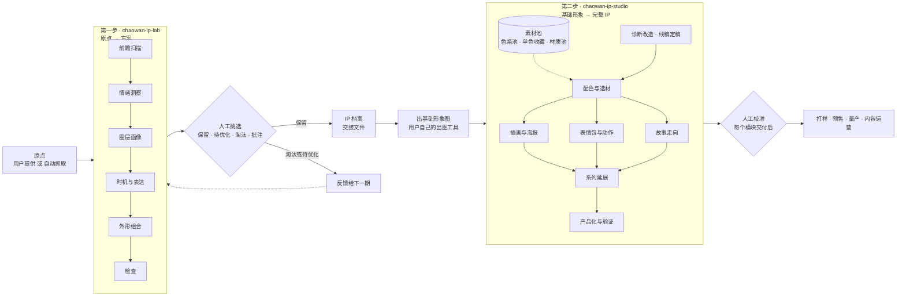

# 潮玩 IP 工作流

版本：2026-10-18 · 第一步 v1.5 · 第二步 v1.1
适用：从一个原点到一个可以量产、可以运营的潮玩 IP

---

## 一、总览

整个工作流分两步，每一步是一个独立的 skill，中间由人来挑选和校准。



| | 第一步 · chaowan-ip-lab | 第二步 · chaowan-ip-studio |
|---|---|---|
| 一句话目标 | 把一个原点变成几个有深度、可比较的 IP 方案 | 把一个选定的基础形象养成一个能卖、能演、能延展的 IP |
| 核心问题 | 为谁做？他们心里有什么话？它长什么样？ | 它怎么动？怎么说话？怎么变成产品和内容？ |
| 输入 | 原点（用户给的，或自动抓取的） | IP 档案 + 基础形象图（或用户自己的形象） |
| 输出 | 方案卡（多个），被选中的方案生成 IP 档案 | 按模块交付：色板、插画方案、表情包、动作库、故事线、系列规划、打样清单 |
| 节奏 | 每周自动跑一期，或用户随时发起 | 选中一个 IP 后按需调用，可以反复多轮 |
| 人的角色 | 标保留、待优化、淘汰，写批注，把喜欢的颜色、材质、原点存入素材池 | 每个模块交付后校准，决定进入哪个模块 |

---

## 二、第一步 · chaowan-ip-lab：原点 → 方案

### 目标

只做一件事：从原点出发，生成几个方向不同、内核扎实、可以直接比较的 IP 方案。它不负责形象出来以后的任何加工。

### 两种入口

- **指定原点**：用户给一个颜色、材质、情绪、性格、画面、一句话
- **自动抓取**：搜索公开网络上的前瞻信号、社会情绪、圈层现象、潮玩动态、节日生肖节点，整理成候选原点，再批量生成（由每周定时任务触发）

### 流程

1. 前瞻扫描：未来 6 到 24 个月的色彩、材质、风格、消费者信号，标时间窗和可信度
2. 情绪洞察：场景、行为、状态、矛盾、没说出口的话，必须到达深层，场景和行为要有来源
3. 圈层画像：是谁、在哪、已经在买什么、黑话符号、怎么晒、怎么破圈
4. 时机与表达：审美钟摆判断站位，从"没说出口的话"长出表达
5. 外形组合：原型、头身比、记忆点、头部元素（公共、专属、反常）、配色、材质、命名
6. 检查：撞车检查、五项测试（闭眼、剪影、简笔画、缩小、换皮）、质量门槛（洞察到达深层、有来源、圈层具体、记忆点成立）

### 不打分

第一步不给方案打分、不排名次。方案好不好，只由用户的选择决定。每一条原点、信号、颜色、材质和洞察都附原文链接，方便点进去看。

### 输出

- **推荐色系**：每期 3 到 5 套，像 VI 一样分主色、辅助色、中性色、点缀色，带调性说明和来源链接，可以整套存入色系池
- **颜色表和材质表**：每期从前瞻扫描里提取，带近似色值、工艺转译、时间窗、可信度和来源链接
- **原点清单**：只收外部信号，每个原点写清发现了什么，附原文链接，标入选、备选或淘汰。用户的评价（如某方案待优化）不算原点
- **方案卡**：每个方案一张，包含洞察、圈层、表达、时机、前瞻信号、外形各层、记忆点、撞车检查、测试、彩蛋、基础形象的出图提示词、风险
- **IP 档案**：用户选中某个方案后生成，作为交给第二步的唯一交接文件（格式见第四节）
- 批量模式下，全部写入仓库 `data/`，在选品板网站 https://ashlandkrug878-wq.github.io/ip/ 上查看。用户在板上给方案标保留、待优化或淘汰并写批注；推荐色系可以整套存入色系池，也可以用色系搭配器从本期颜色和单色收藏里自己组一套；材质和原点可以存入材质池、原点池，每张方案卡上都有它对应原点的保存按钮。**色系池、单色收藏、材质池留给第二步配色选材用；原点池作为下一期的候选原点**

### 不做什么

诊断已有形象、配色微调、插画和表情包、动作、故事、系列、联名、工艺和打样，这些全部交给第二步。

---

## 三、第二步 · chaowan-ip-studio：基础形象 → 完整 IP

### 目标

拿到一个已经选定的基础形象，让它从"一张图"变成一个有动作、有性格、有故事、有产品线的 IP。每个模块都可以单独调用，不必按顺序全部走完。

### 输入

- 第一步交来的 IP 档案，加上用户用出图工具生成的基础形象图
- 或者用户自己已有的形象（没有档案时，第一个模块先补一份档案）

### 七个模块

| 模块 | 解决什么 | 交付物 |
|---|---|---|
| 1. 诊断改造 | 形象出来后哪里不对、有没有别人的影子 | 诊断报告、保留删改清单、改版提示词 |
| 2. 配色与选材 | 线稿定稿后，从色系池挑配色、从材质池挑材质 | 候选色系及理由、角色色板、材质及部位、上色提示词、灰度与缩小检查 |
| 3. 插画与海报 | 主视觉和系列海报怎么画 | 画风说明、构图方案、场景清单、出图提示词 |
| 4. 表情包与动作 | 它怎么动、怎么表达情绪 | 经典动作库、表情包清单（含圈层黑话文案）、短视频动作分镜 |
| 5. 故事走向 | 它的世界、关系、故事怎么展开 | 世界观、关系图、季度故事线、短视频脚本模板 |
| 6. 系列延展 | 下一个系列做什么、怎么不跑偏 | 系列规划、换装方案、节点日历、联名方向、裂变判断 |
| 7. 产品化与验证 | 能不能做出来、值不值得做 | 品类和工艺转译、打样清单、成本风险、验证路径和投产门槛 |

### 共同原则

- **不变量不能动**：表达、记忆点、轮廓、头身比、签名色写在 IP 档案里，任何模块都不能改；要改，先回到诊断模块判断是升级还是裂变
- **每个模块交付后都更新档案**：新增的经典动作、口头禅、故事设定、配色都写回 IP 档案，保持唯一真相
- **先线稿，后配色，再选材**：配色和材质从用户的素材池里挑，池里没有合适的才提议新的
- **按载体排优先级**：主载体是短视频的，先做表情包与动作和故事；主载体是实物的，先做配色和产品化

---

## 四、交接格式：IP 档案

IP 档案是两步之间唯一的交接文件，也是第二步所有模块的共同依据。第一步生成初版，第二步每个模块完成后更新。

```markdown
# IP 档案：<名字>（<英文名>）
版本：v1 · 来源：第 N 期方案 X · 更新日期

## 不变量（任何模块都不能改）
- 表达：
- 记忆点：
- 轮廓与头身比：
- 签名色：
- 核心性格：

## 内核
- 洞察：场景 / 行为 / 状态 / 矛盾 / 没说出口的话（附来源）
- 圈层：是谁 / 在哪 / 已经在买什么 / 黑话符号 / 怎么晒 / 破圈路径
- 时机站位：

## 外形
- 原型 · 物种 · 体型 · 招牌姿势 · 命名
- 头部元素（逐项，带公共、专属、反常标签）
- 主色 · 细节密度 · 手感

## 内容（第二步逐步补充）
- 主载体 · 次载体
- 经典动作库：
- 口头禅与常用文案：
- 关系与世界观：
- 故事线：

## 变量（可以随系列变）
- 服装 · 配色 · 场景 · 材质 · 联名

## 产品（第二步补充）
- 首发品类与工艺 · 价格带 · 稀缺机制 · 节点

## 变更记录
- 日期 · 模块 · 改了什么 · 为什么
```

---

## 五、人工校准点

AI 负责生成，人负责定义什么是好。工作流里有三个固定的校准点：

1. **选品**（第一步之后）：在选品板上给方案标保留、待优化或淘汰，写批注；把喜欢的色系、材质、原点存入素材池。批注会直接成为下一期的约束
2. **定稿基础形象**（进入第二步之前）：用出图工具出图，挑出最接近方案的一张，作为第二步的输入
3. **模块校准**（第二步每个模块之后）：确认交付物，决定下一个进入哪个模块

决策原则：便宜的环节（出方案、出图）听设计师自己的；贵的环节（开模、量产）听数据。相信腿不相信嘴：付费 > 粉丝增长 > 点赞和评论。

---

## 六、自动化

- **每周一期**：定时任务按第一步的自动抓取入口运行，读取上一期用户的选择、批注和原点池，生成新一期写入仓库 `data/`，推送后流水线自动加出图任务并出图
- **只按用户的选择学习**：保留的进入第二步，待优化的下一期出优化版，淘汰的同类方向不再出现，没标记的不据此调整；批注最优先；原点池里的原点作为下一期候选。色系池、单色收藏、材质池不用于第一步，留给第二步配色选材。约三分之一保留探索方向
- **不参考 AI 自己的判断**：AI 不打分、不排名，避免它用自己的标准替你做选择
- **第二步不自动化**：它依赖人工挑选的形象和每个模块后的校准，由用户按需发起

---

## 七、已知限制

- 公开搜索抓不到小红书、抖音的大部分内容；能接入内部热点数据时，信号会准很多
- skill 不能直接出图，只提供出图提示词，图由用户的出图工具生成
- 前瞻信号有时效，每次运行都要重新搜索；色彩机构的年度色通常提前一年半到两年发布
- 方案只是候选，不是销量预测；任何方案都要经过低成本发布和预售验证
- 颜色的色值是根据官方描述估算的近似值，打样以官方色卡为准
