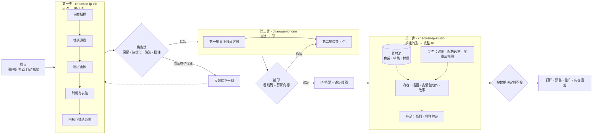

# 潮玩 IP 工作流

版本：2026-10-19 · 第 0 步 study v0.3 · 第一步 lab v2.0 · 第二步 form v1.0 · 第三步 studio v2.0
适用：从一个原点到一个可以量产、可以运营的潮玩 IP

---

## 一、总览

整个工作流分三步，每一步是一个独立的 skill，每一步之后都由人来挑选。三个挑选关卡分别回答三个问题：**说什么对？长什么样对？能不能做成产品？**

| | 第一步 · lab | 第二步 · form | 第三步 · studio |
|---|---|---|---|
| 一句话目标 | 从原点找到表达 | 给表达找到对的形 | 把锁定的形养成能卖、能演、能延展的 IP |
| 输入 | 原点 | 保留的表达卡 | IP 档案 + 锁定线稿 |
| 输出 | 表达卡（不含外形） | 黑白线稿方向（带剪影角标），锁定后出 IP 档案 | 色板、渲染、三视图、内容、系列、打样清单 |
| 出图 | 不出图 | 线稿 | 上色、渲染、三视图、表情、海报 |
| 人的角色 | 挑表达，存原点、颜色、材质 | 挑形、写批注、锁定 | 每个模块后校准，看数据决定投产 |
| 选品板栏目 | ① 表达 | ② 找形 | ③ 定型 |

**第 0 步 · chaowan-ip-study（研究）**在三步之外，随时可以用：研究已有 IP 为什么成功或失败，写成对标卡（`data/studies/`），网站「研究库」栏目横向比较。lab 用它判断表达和时机是否拥挤，form 用它做撞车检查，studio 用它参照品类和系列节奏。分速查、标准、深挖三档，分类字段和 lab、form 用同一套词。

为什么拆成三步：一张卡里同时有表达和成品图时，人会被图的好坏带着走；形还没找对就上颜色和材质，画面靠质感撑着，看不出造型好不好；一个表达只出一张图，AI 给的往往是最平均的解。

---

## 二、第一步 · chaowan-ip-lab：原点 → 表达卡

- **两种入口**：指定原点（默认 3 张卡）；自动抓取（默认 6 张卡，附原点清单、推荐色系、颜色表、材质表）
- **流程**：读原点池和上一期选择 → 前瞻扫描 → 情绪洞察（五要素，三层深度）→ 圈层画像 → 时机与表达（五种句式）→ 内核与情绪范围 → 内容与商业方向 → 检查
- **表达卡的关键新字段**：核心性格、情绪范围（可以 / 不可以）、它在做什么（表达里的动作）。这三样是第二步的硬约束
- **不做**：外形、出图提示词、五项测试、IP 档案

## 三、第二步 · chaowan-ip-form：表达 → 形

- **五条轴**：① 原型 ② 整体轮廓 ③ 记忆点（位置不限）④ 五官 ⑤ 情绪表达（只在表达卡的情绪范围内变）。反常点跟随（0 到 2 处），线条语言整轮固定
- **第一轮 6 个**：任意两个至少两条轴不同；原型和轮廓不能同时相同；记忆点至少覆盖三个位置；至少一个物件或抽象原型
- **第二轮裂变 4 个**：保留的形，原型和轮廓不动，只变记忆点细节、五官、反常点
- **出图**：白底黑白线稿，正面全身，右下角同姿态小黑剪影；不写颜色、材质、灯光
- **裁切检验**：记忆点不在头上时，写清头像裁切后靠什么认
- **锁定**：生成 IP 档案（不变量写进原型、轮廓、记忆点、五官、核心情绪），线稿成为第三步的参考图

## 四、第三步 · chaowan-ip-studio：锁定的形 → 完整 IP

| 段 | 模块 |
|---|---|
| 定型 | 1 诊断 · 2 配色与选材（从素材池挑）· 3 渲染与三视图 |
| 内容 | 4 插画与海报 · 5 表情包与动作 · 6 故事走向 |
| 产品 | 7 系列延展 · 8 产品化与验证 |

原则：不变量不能动；不改形（所有出图以锁定线稿为参考图）；先线稿，后配色，再选材；每个模块交付后更新 IP 档案；造型要大改时回到找形。

---

## 五、交接格式

- **表达卡**：`data/ips/<方案 id>.json`，`stage` 为 `expression`
- **形**：`data/forms/<方案 id>-<轮次字母><序号>.json`
- **IP 档案**：`ip-archives/IP档案_<名字>_vN.md`，模板见 `skills/chaowan-ip-form/references/handoff.md`

---

## 六、人工校准点

AI 负责生成，人负责定义什么是好。

1. **挑表达**（第一步之后）：在选品板「① 表达」标保留、待优化、淘汰，写批注；把喜欢的色系、材质、原点存入素材池
2. **挑形**（第二步之后）：在「② 找形」看线稿，保留的往下裂变，满意了让 Claude 锁定
3. **模块校准**（第三步每个模块之后）：确认交付物，决定下一个模块
4. **投产**：便宜的环节（出方案、出图）听自己的；贵的环节（开模、量产）听数据。相信腿不相信嘴：付费 > 粉丝增长 > 点赞和评论

---

## 七、出图与自动化

- **出图**：没有配置出图 API 时，在选品板详情里复制提示词，去 ChatGPT 出图，下载后点上传；网站自动压缩、存进 `images/`、更新队列
- **流水线**：`data/` 或队列变动时，GitHub Action 自动重建索引、给新的方案和形加出图任务，配置了密钥时自动出图
- **每周一期（待 2.0 稳定后开启）**：定时任务按第一步自动抓取入口运行，读取上一期选择、批注和原点池，生成新一期表达卡写入仓库
- **只按用户的选择学习**：保留的进入找形，待优化的出优化版，淘汰的同类方向不再出现，没标记的不据此调整；批注最优先；约三分之一保留探索方向
- **第二、三步不自动化**：依赖人工挑选，由用户按需发起

---

## 八、已知限制

- 公开搜索抓不到小红书、抖音的大部分内容；能接入内部热点数据时，信号会准很多
- Claude 不能直接出图，只提供提示词；线稿质量取决于出图工具对"只画线稿"的执行，偶尔会被画成上色图，需要重出
- 前瞻信号有时效，每次运行都要重新搜索
- 方案和形只是候选，不是销量预测；任何 IP 都要经过低成本发布和预售验证
- 颜色色值是近似值，打样以实物色卡为准

## 九、版本记录

- 2026-10-19 · study v0.3：研究 skill 改名 chaowan-ip-study，定为第 0 步；分三档；新增对标卡和受控词表；删除复刻提示词；接入研究库栏目。样本：星星人、THE MONSTERS 速查卡

- 2026-10-19 · 2.0：拆成三步。新增第二步 chaowan-ip-form（找形）：五条轴、6 + 4 两轮、白底线稿加剪影角标；第一步只出表达卡；第三步按定型、内容、产品分段。选品板改为按阶段分栏
- 2026-10-19 · 1.6（ChatGPT 修订）：补造型规格、提示词规范和证据阶段；重写两期 12 个方案的提示词。造型规格和证据规则已并入 form
